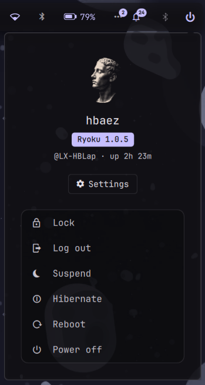

# Power Menu V2

A profile-style session menu on the QS Bar: your Hub avatar and name, the Ryoku
version and uptime, a Settings button, and the six session actions.



## What it does

- **Widget** — a power glyph on the QS Bar. A click only opens the panel; the
  glyph never runs an action by itself.
- **Panel** — avatar and name from the Hub's Profile page, a Ryoku version
  badge, `@hostname · up …`, a Settings button that opens the Hub, then Lock,
  Log out, Suspend, Hibernate, Reboot and Power off in one group. Hibernate is
  shown when login1 reports it possible (`yes`, or `inhibited` by the shell's
  own sleep block, which lifts once the screen is locked). With "Ask before
  acting" on, every action except Lock needs a second click within four
  seconds; closing the panel always drops an armed action. Every colour comes
  from the plugin kit `Theme`, so it follows the Ryoku theme and wallpaper.
- **Service** — runs the actions through Ryoku's own session commands and reads
  the profile data. Nothing is compositor- or edition-specific: no `hyprctl`,
  `systemctl`, `journalctl` or package-manager calls.

## Install

From this folder on a Ryoku desktop:

```
ryoku plugin validate .
ryoku plugin add . --bar --yes
```

Or install from **Ryostore → Plugins** once it is listed, then enable and place
it under **QS Bar Settings → Community**.

## How it plugs in

- `service/Main.qml` — session actions, the confirm flow, the login1 hibernate
  probe and the read-only profile data.
- `content/Widget.qml` — the bar glyph; a click calls `pluginApi.togglePanel()`.
- `content/Panel.qml` — the profile block and action group; rows call the
  service, which closes the panel after running an action.

`hosts` is `topbarGlyph` only.

### What it runs

| Command | When |
| --- | --- |
| `ryoku-shell lock` | Lock click, or first step of a confirmed Hibernate |
| `ryoku-shell suspend` | Confirmed Suspend (the shell locks first) |
| `call session.logout {}` on `$XDG_RUNTIME_DIR/ryoku-shell.sock` | Confirmed Log out (the same call the shell's own session menu makes) |
| `ryoku-host power reboot` | Confirmed Reboot |
| `ryoku-host power poweroff` | Confirmed Power off |
| `ryoku-host power hibernate` | Confirmed Hibernate, once login1 reports `CanHibernate` = `yes` after locking (polled every 300 ms, up to about 12 s). Inhibitors are respected: if another app still blocks sleep, it gives up and the session stays locked |
| `ryoku-shell hub open` | Settings button |
| `busctl --system call org.freedesktop.login1 /org/freedesktop/login1 org.freedesktop.login1.Manager CanHibernate` | When the service loads and when the panel opens (to show the row), and while waiting to hibernate |
| `ryoku-host pkg version ryoku` | When the panel opens (version badge) |
| `uname -n`, `cat /proc/uptime` | When the panel opens (hostname, uptime) |

### What it reads

`~/.config/ryoku/profile.json` (`text.name` and the `hero` settings) and the
image it points at, the same way the Hub's Profile page does: the bundled
`profile-hero.png`, a gallery image in `<Pictures>/ryodecors/`, or a custom
image in `~/.config/ryoku/profile/`. The Pictures folder comes from
`~/.config/user-dirs.dirs`, so a localized folder such as `~/Imágenes` works.
With no `profile.json`, the name falls back to your login name, as in the Hub.

### What it never does

- No network access.
- No privileged escalation (`pkexec` / `sudo` / `doas` / `su`).
- No writes anywhere.
- No compositor-specific tools.

## Settings

| key | type | default | description |
| --- | --- | --- | --- |
| confirm | toggle | true | Ask before acting (click twice) |
| show_lock | toggle | true | Show Lock |
| show_logout | toggle | true | Show Log out |
| show_suspend | toggle | true | Show Suspend |
| show_hibernate | toggle | true | Show Hibernate (still hidden if the machine can't hibernate) |
| show_reboot | toggle | true | Show Reboot |
| show_poweroff | toggle | true | Show Power off |

## Develop

```
power-menu-v2/
  manifest.json             # id, version, hosts, entry points, files
  service/Main.qml          # session actions and profile data
  content/Widget.qml        # bar glyph
  content/Panel.qml         # profile block and action group
  assets/preview-widget.png # README / Store preview
  LICENSE                   # MIT
```

## Source

[https://github.com/hectorbaez81/power-menu-v2](https://github.com/hectorbaez81/power-menu-v2)

## Maintenance & safety

A community contribution, maintained by its author, not the Ryoku team.

## Credits

Héctor Báez \<hector.baez@gmail.com\>. MIT licensed. See [LICENSE](LICENSE).
